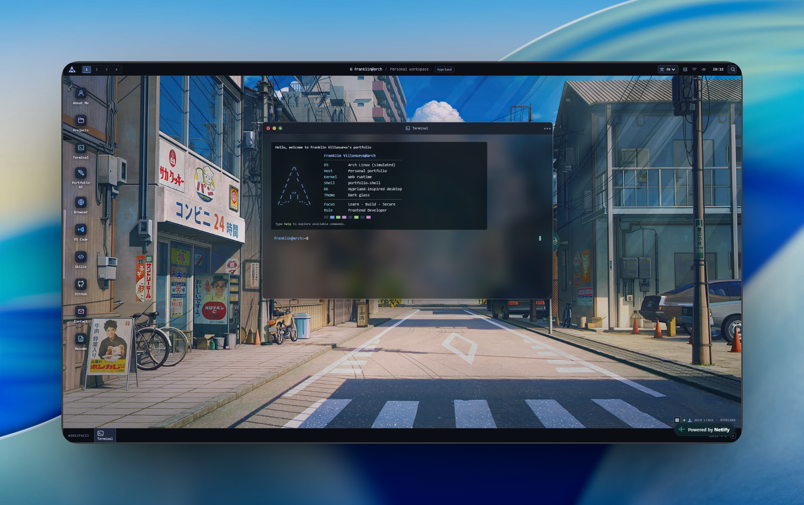
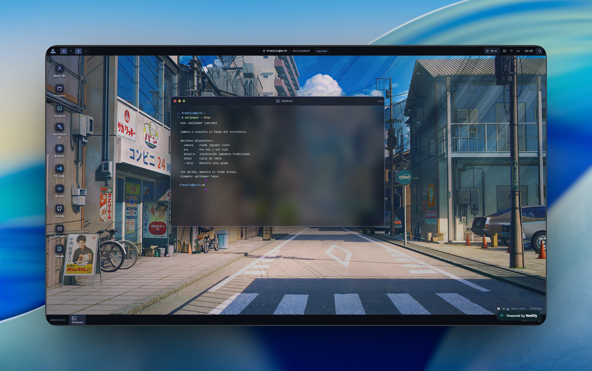
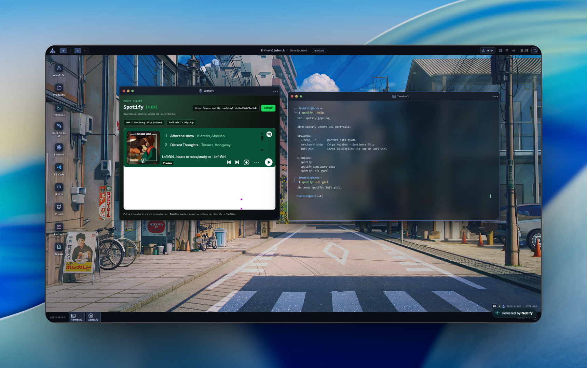
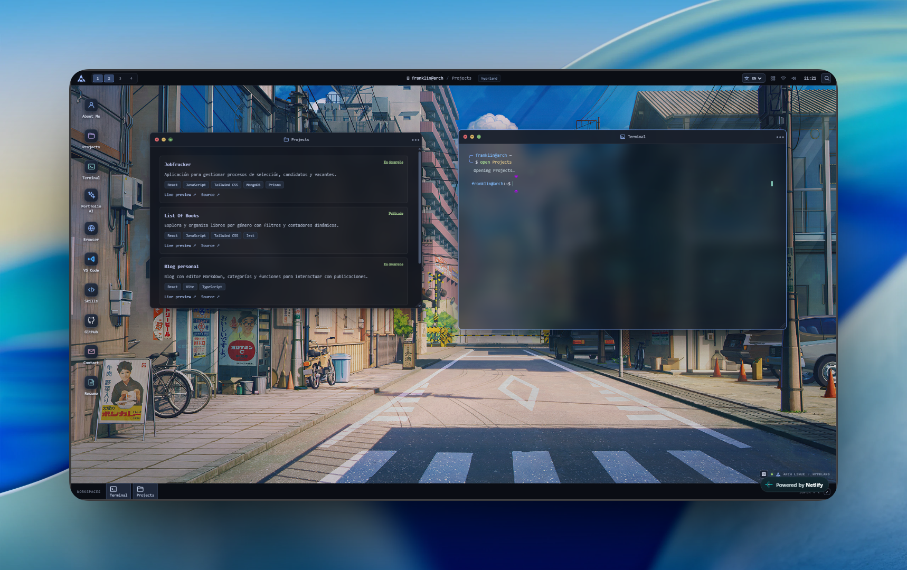
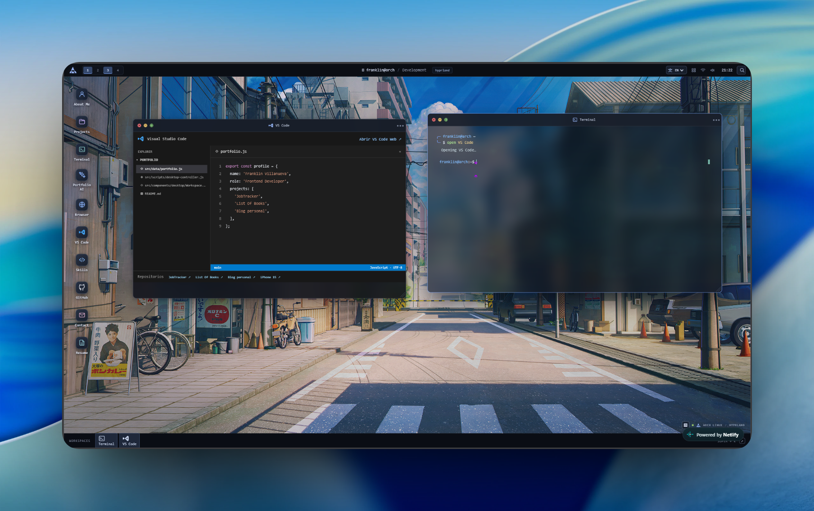
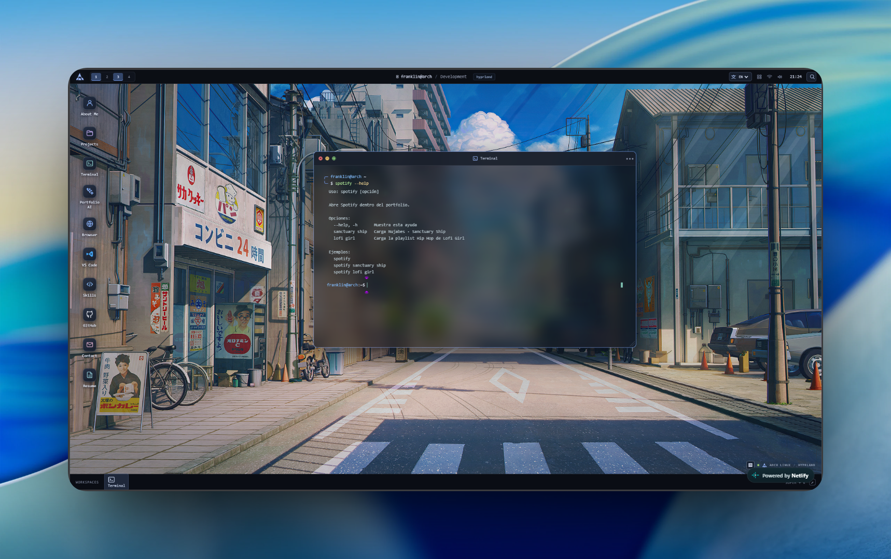

<div align="center">

# Arch Linux Portfolio

### A personal portfolio that turns a Linux desktop into an interactive web experience.

[](https://astro.build/)
[](https://developer.mozilla.org/docs/Web/JavaScript)
[](https://ai.google.dev/)
[](https://archlinux-portafolio.netlify.app/)

[Explore the portfolio](https://archlinux-portafolio.netlify.app/) · [Report an issue](https://github.com/Fran-web-dev/ArchLinuxPortafolio/issues)

<br />



</div>

## Screenshots

Each screenshot highlights a different part of the portfolio. The terminal can launch applications and provide help for interactive commands, while the desktop lets you use tools such as Projects, VS Code, and Spotify in separate windows.

<table>
  <tr>
    <td align="center"><strong>Wallpaper command</strong><br />Use <code>wallpaper --help</code> in the terminal to see the available desktop backgrounds and how to switch between them.<br /></td>
    <td align="center"><strong>Spotify player</strong><br />The Spotify window embeds a playlist in the desktop, alongside the terminal with the Spotify app open.<br /></td>
  </tr>
  <tr>
    <td align="center"><strong>Projects window</strong><br />Browse selected projects, their descriptions, technology tags, live demos, and source repositories.<br /></td>
    <td align="center"><strong>VS Code window</strong><br />Preview a simulated code editor with portfolio files and repository links, then open VS Code Web from its toolbar.<br /></td>
  </tr>
  <tr>
    <td align="center"><strong>Ask about the profile</strong><br />The terminal can answer questions about Franklin's profile and portfolio using the <code>ask</code> command.<br /></td>
    <td align="center"><strong>Spotify terminal commands</strong><br />Run <code>spotify --help</code> to see shortcuts for opening Spotify and loading the featured playlists.<br /></td>
  </tr>
</table>

## About the project

This portfolio presents the profile, experience, and projects of **Franklin Villanueva**, a frontend developer from Honduras. Its interface recreates a desktop inspired by Arch Linux and Hyprland, with portfolio sections presented as app windows across four workspaces.

The experience supports English and Spanish and adapts to small screens. It is built with Astro, JavaScript, and CSS, and integrates Google Gemini into the assistant and terminal.

## Explore the desktop

| App | What you'll find |
| --- | --- |
| **About Me** | Professional profile, interests, experience, and education. |
| **Projects** | Selected projects, technologies, and links to demos and repositories. |
| **Skills** | Development technologies and tools. |
| **GitHub** | Public profile, repositories, and recent activity. |
| **Contact** | Email, LinkedIn, and personal website. |
| **Resume** | A section prepared for a résumé. |
| **Terminal** | A simulated shell with interactive commands and Gemini queries. |
| **Portfolio AI** | A Gemini assistant for questions about the profile and projects. |
| **Browser, VS Code, and Spotify** | Simulated apps for exploring the desktop experience. |

You can also switch workspaces, find apps with the launcher, change the wallpaper, and switch the interface language.

## Getting started

### Requirements

- Node.js `>=22.23.4`
- pnpm `11.25.0`

### Install and run

```bash
pnpm install
pnpm dev
```

Astro serves the site at `http://localhost:4321` by default. To build and serve the production version:

```bash
pnpm build
pnpm start
```

## Commands

| Command | Action |
| --- | --- |
| `pnpm dev` | Starts Astro in the background. |
| `pnpm build` | Creates a production build in `dist/`. |
| `pnpm preview` | Previews the Astro build. |
| `pnpm start` | Serves the production build locally. |

Try the [deployed portfolio](https://archlinux-portafolio.netlify.app/) to use the Gemini assistant or explore the terminal. Run `help` to see available commands, or ask a question such as `ask What projects has Franklin built?`.

## Deployment

The site is deployed on [Netlify](https://archlinux-portafolio.netlify.app/). Open it to try the features directly.

## Technologies

**Astro · JavaScript · CSS · Google Gemini · Netlify**

---

<div align="center">
  Made by <a href="https://github.com/Fran-web-dev">Franklin Villanueva</a> · <a href="mailto:franklinevillanueva4@gmail.com">Contact</a>
</div>
